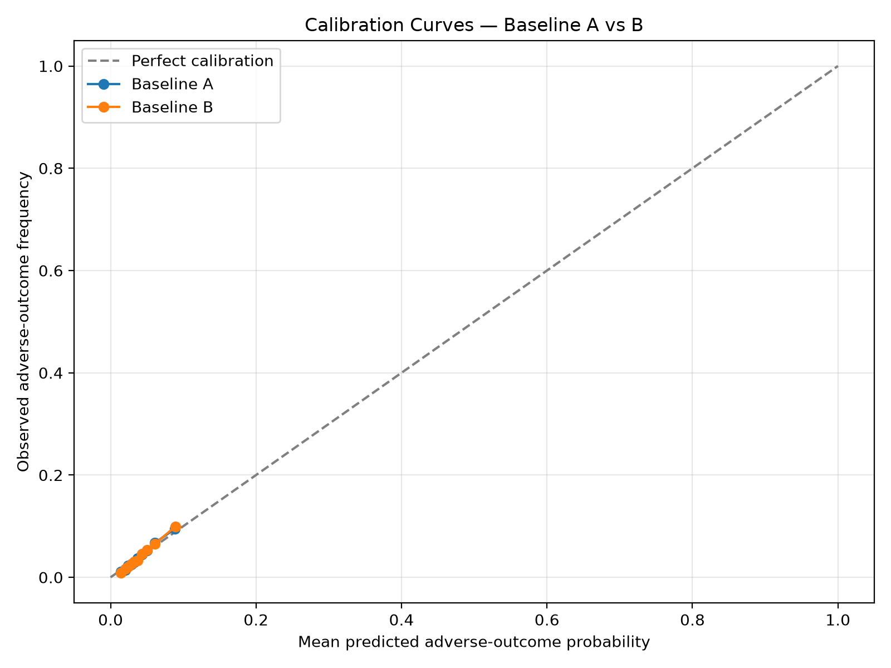
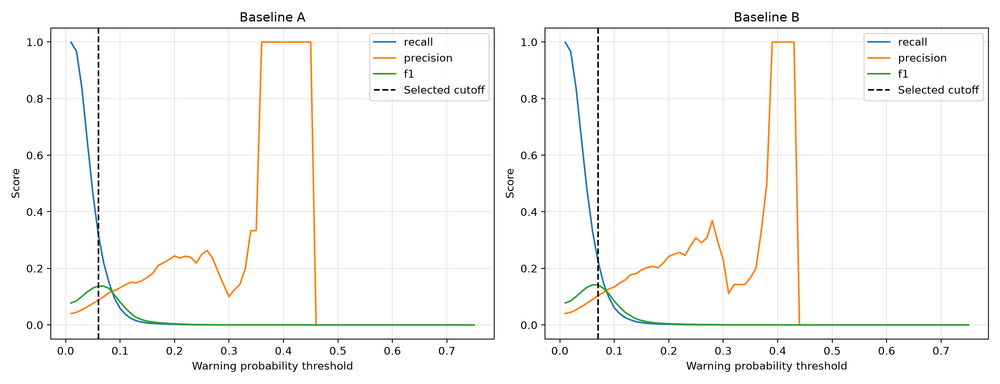

# Predicting Organ Transplant Waitlist Outcomes & Optimizing Allocation

**Healthcare 1C · Break Through Tech AI Studio · Fall 2026**

A collaborative research project exploring kidney transplant waitlist risk, model interpretability, and allocation patterns. The challenge is described in the [project overview](Challenge-Project-Overview.md), which introduces MediMate Foundation and the project's broader classification, survival-analysis, and fairness goals.

## Objectives and current scope

- Predict adverse waitlist outcomes and compare interpretable logistic regression with Random Forest baselines.
- Assess probability calibration and the tradeoff between missed adverse outcomes and false alarms.
- Develop explainability and subgroup evaluation, and work toward the broader time-to-transplant objective.

The committed artifacts currently document classification baselines and exploratory evaluation. Completed survival modeling, clinical deployment, and a validated fairness assessment are not established by these artifacts. This is research software, not a clinical decision system.

## Repository guide

| Location | Purpose |
| --- | --- |
| [Project overview](Challenge-Project-Overview.md) | Challenge context, milestones, and broader objectives |
| [Data guide](data/README.md) and [data dictionary](data/data_dictionary.md) | Data access, field meanings, and handling guidance |
| [Preprocessing notebook](notebooks/Healthcare1C.ipynb) | Exploration, date checks, feature engineering, and preprocessing |
| [Model documentation](models/README.md) | Training design, artifact input contract, results, and limitations |
| [Notebooks](notebooks/) | Logistic regression, Random Forest, calibration, baseline evaluation, and feature explanations |
| [Issue #20 outputs](outputs/issue_20/) | Aggregate threshold tables, calibration curves, and decile-lift results |

## Data exploration and methodology

The challenge overview describes a restricted OPTN kidney waitlist extract with 494,862 listing-level records and 38 columns. Access and reuse must follow the [data guide](data/README.md); public repository availability does not establish permission to redistribute patient-level information.

The committed processed-model metadata describes **439,887 rows, 51 numeric features, and 17,587 positive outcomes (approximately 4%)**. These are different stages of the workflow, so their row counts and endpoint rates should not be treated as interchangeable. The processed target and its provenance should be checked against the source documentation before interpreting results.

The preprocessing notebook documents 59 records with an end date before the listing date and 790 internally consistent same-day outcomes. It also explores missingness, clinical features available at listing, and transformations. See the notebook and data dictionary for the actual decisions.

### Classification baselines

- **Baseline A:** 30 predictors after demographic exclusions.
- **Baseline B:** all 51 processed predictors, including demographic features.
- **Split:** stratified 80/20 train/test split, random seed 42.
- **Logistic regression:** 200 hyperparameter candidates, five-fold training cross-validation, selection by average precision. A scaler is fitted inside the training pipeline.
- **Random Forest:** eight candidates with three-fold training cross-validation, selected by average precision; separate A and B training notebooks and metadata.
- **Threshold evaluation:** the logistic-regression calibration notebook generates training out-of-fold probabilities, selects exploratory F1-based cutoffs, and reports held-out performance, calibration, and top-decile lift.

Including or excluding demographics alone does not establish fairness. Upstream imputation and scaling provenance is incomplete, and patient identifiers are unavailable for grouped validation. These limitations are detailed in [models/README.md](models/README.md).

## Recorded results and key findings

### Logistic regression baseline ranking

| Metric | Baseline A | Baseline B |
| --- | ---: | ---: |
| Held-out average precision | 0.080930 | 0.085460 |
| Held-out ROC AUC | 0.677869 | 0.683379 |
| Adverse-class recall at 0.50 | 0.000000 | 0.000000 |

Source: [model documentation](models/README.md). At the default cutoff, both models miss all 3,517 adverse outcomes in the test set. Approximately 96% accuracy therefore reflects the majority class rather than useful adverse-event detection.

### Exploratory logistic regression thresholds

| Baseline | Cutoff | Recall | Precision | F1 |
| --- | ---: | ---: | ---: | ---: |
| A | 0.06 | 0.3287 | 0.0860 | 0.1363 |
| B | 0.07 | 0.2374 | 0.1020 | 0.1427 |

Source: [saved threshold results](outputs/issue_20/selected_threshold_test_results.csv). Lower thresholds recover more adverse cases at the cost of many false positives. These recorded thresholds are exploratory, are not clinical recommendations, and must not be retuned against the reported held-out test results.

The Random Forest Baseline B documentation reports held-out average precision **0.107480** and ROC AUC **0.700067**, while recall remains zero at the default 0.50 cutoff. Random Forest calibration and cost-sensitive cutoff analysis remain tracked in [Issue #39](https://github.com/Break-Through-Tech/Healthcare-1C-predicting-organ-transplant-waitlist-outcomes-and-optimizing-allocation/issues/39).

### Evaluation figures





[Decile-lift table](outputs/issue_20/decile_lift_results.csv) · [Baseline A threshold sweep](outputs/issue_20/baseline_a_threshold_cv.csv) · [Baseline B threshold sweep](outputs/issue_20/baseline_b_threshold_cv.csv)

## Local setup and reproduction guide

These instructions describe the committed notebook workflow. A clean-environment execution of the full workflow has not been verified as part of this documentation update.

1. Clone the repository and enter its root directory:

   ```bash
   git clone https://github.com/Break-Through-Tech/Healthcare-1C-predicting-organ-transplant-waitlist-outcomes-and-optimizing-allocation.git
   cd Healthcare-1C-predicting-organ-transplant-waitlist-outcomes-and-optimizing-allocation
   python -m venv .venv
   ```

2. Activate the environment: `source .venv/bin/activate` on macOS/Linux, or `.venv\Scripts\activate` on Windows. Install the model dependencies and notebook interface:

   ```bash
   python -m pip install -r models/requirements.txt
   python -m pip install jupyterlab
   jupyter lab
   ```

   The root `requirements.txt` is currently empty; use `models/requirements.txt`. The feature-importance notebook additionally needs `shap`; the upstream preprocessing notebook imports `imbalanced-learn` and Google Colab-specific functionality. Recorded versions may require a compatible Python environment; consult model metadata if package resolution fails.

3. Follow [data/README.md](data/README.md) to obtain authorized source data. For the existing classification workflow, ensure the approved processed files `X_processed.csv`, `y_processed.csv`, and `dataset_metadata.json` are available in `processed_output/`. Keep row indices and feature order intact. Do not add restricted raw data or individual predictions to new commits.

4. For training, open and run each notebook from top to bottom:
   - [Logistic regression A](notebooks/logistic_regression_training_Baseline%20A.ipynb)
   - [Logistic regression B](notebooks/logistic_regression_training_Baseline%20B.ipynb)
   - [Random Forest A](notebooks/random_forest_training_Baseline_A.ipynb)
   - [Random Forest B](notebooks/random_forest_training_Baseline_B.ipynb)

   The notebooks discover the repository root and validate processed data. Training writes fitted models, metadata, and cross-validation results to `models/`. Random Forest fitted pickle artifacts are not currently present in the main-branch file listing and must be produced by training before use.

5. For calibration and threshold evaluation, open [model_calibration_threshold_analysis.ipynb](notebooks/model_calibration_threshold_analysis.ipynb). Its data directory is `ROOT / "processed_output"`, matching this repository's folder layout. Load the trusted logistic-regression artifacts, run all cells in order, and inspect the aggregate outputs in `outputs/issue_20/`.

6. Review recall, precision, confusion matrices, average precision, calibration, and lift together. Compare the metadata's source hashes and split settings before comparing different artifact revisions. Pass processed features directly to the saved logistic-regression pipeline without applying another scaler.

### User and interface guide

The current interface is a collection of Jupyter notebooks and fitted scikit-learn models, rather than a deployed application or HTTP API. The model input contract and loading example are in [models/README.md](models/README.md). Saved model metadata defines the exact feature order and positive class. Raw patient records cannot be passed directly to the processed-feature models.

A separately approved synthetic sample dataset is not currently documented; public readers can inspect aggregate CSVs, notebook outputs, and figures without reproducing restricted records. The team should add a clearly labeled, non-patient sample for interface testing when approved.

## Individual contributions

This work is collaborative. The [commit history](https://github.com/Break-Through-Tech/Healthcare-1C-predicting-organ-transplant-waitlist-outcomes-and-optimizing-allocation/commits/main/) and linked issues preserve authorship and task ownership.

**Danielle Nyame ([@dnyame1](https://github.com/dnyame1))** completed the calibration, threshold, and decile-lift task tracked in [Issue #20](https://github.com/Break-Through-Tech/Healthcare-1C-predicting-organ-transplant-waitlist-outcomes-and-optimizing-allocation/issues/20), with the associated notebook and aggregate outputs linked above. Her assigned follow-up is Random Forest calibration, cost-sensitive threshold sweeps, and lift analysis in Issue #39; that follow-up remains open. This contribution summary is not a complete team roster.

## Next steps and limitations

- Complete Random Forest calibration and cost-sensitive operating-point evaluation.
- Validate preprocessing provenance, avoid leakage, and establish patient-group or temporal evaluation where possible.
- Audit subgroup performance with uncertainty estimates; do not infer fairness from demographic exclusion.
- Complete and document survival-analysis endpoints, censoring, and competing outcomes.
- Consolidate notebook paths and dependencies and verify a clean-environment reproduction.
- Add an approved synthetic example dataset and a complete team contribution table.

## Acknowledgements and reuse

Developed through Break Through Tech AI Studio with the Healthcare 1C team and challenge guidance described in the project overview. No software license is declared here; data access and reuse remain governed by the applicable source terms. License selection requires the project team's and advisor's review.
